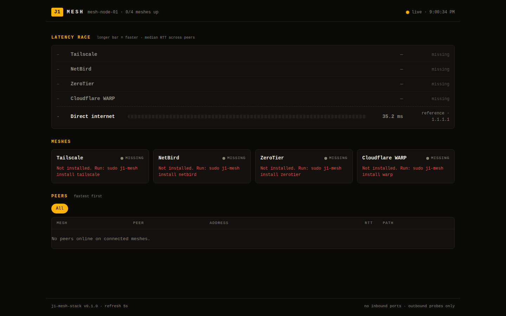

# j1-mesh-stack

A mesh VPN stack you can deploy **without opening a single inbound port**, with a live dashboard that shows which mesh is responding fastest.

One command installs Cloudflare WARP (connector mode), Tailscale, NetBird and ZeroTier from their signed apt repositories, enrolls the node, and starts a latency dashboard that races them against each other.

```bash
curl -fsSL https://raw.githubusercontent.com/OneByJorah/j1-mesh-stack/main/install.sh | sudo bash
```

Pick providers, or pin a release:

```bash
curl -fsSL https://raw.githubusercontent.com/OneByJorah/j1-mesh-stack/main/install.sh | sudo bash -s -- tailscale netbird
curl -fsSL https://raw.githubusercontent.com/OneByJorah/j1-mesh-stack/main/install.sh | sudo JMS_REF=v0.1.0 bash
```

Or install the `.deb` from the [Releases](https://github.com/OneByJorah/j1-mesh-stack/releases) page, then `sudo j1-mesh install`.

Debian / Ubuntu family (apt) only for now. WireGuard-by-hand is intentionally not included.

## The no-open-ports model

| Layer | What happens |
|---|---|
| Enrollment | Outbound HTTPS to each vendor's control plane. |
| Peer traffic | NAT traversal initiated from your side (hole punching), with vendor relays as fallback (Tailscale DERP, NetBird relay, ZeroTier roots, Cloudflare edge). |
| Firewall / router | **This project never creates a firewall rule, UPnP mapping or port-forward.** |
| Dashboard | Binds to `127.0.0.1` by default. `J1_MESH_BIND=tailscale` binds to your Tailscale IP only. Wildcard binds are refused. |

Honest detail: the mesh daemons do bind local UDP sockets (for example `tailscaled` on 41641, `zerotier-one` on 9993). That is how they send and receive hole-punched traffic. No inbound allow rule is needed for them; if hole punching fails between two peers, traffic falls back to a relay and still works, just with higher latency. `sudo j1-mesh doctor` lists those sockets and flags any firewall rule that opens them.

## Providers

| Provider | Install source | Enroll with | Notes |
|---|---|---|---|
| Cloudflare WARP | `pkg.cloudflareclient.com` apt repo | `WARP_CONNECTOR_TOKEN` | Connector mode. Writes `/etc/sysctl.d/99-zzz-cloudflare-warp-connector.conf` (IP forwarding). Disable with `WARP_ENABLE_FORWARDING=0`. |
| Tailscale | `pkgs.tailscale.com` apt repo | `TS_AUTHKEY` or interactive login | |
| NetBird | `pkgs.netbird.io` apt repo | `NB_SETUP_KEY` | Cloud-managed by default. |
| ZeroTier | `download.zerotier.com` apt repo (falls back to ZeroTier's GPG-verifying installer) | `ZT_NETWORK_ID` | Authorize the node in ZeroTier Central. |

Each vendor has its own free plan and limits; check their current terms for what fits your device count.

## Quick start

```bash
sudo j1-mesh install                 # installs everything, creates /etc/j1-mesh/*.env
sudoedit /etc/j1-mesh/mesh.env       # add your enrollment keys
sudo j1-mesh up                      # connect every installed provider
sudo j1-mesh doctor                  # health + inbound-exposure audit
```

Open the dashboard at `http://127.0.0.1:8787`. From another device on your tailnet:

```bash
sudo tailscale serve --bg 8787
```

Or over SSH: `ssh -L 8787:127.0.0.1:8787 your-host`.

## Dashboard

- **Latency race**: providers ranked by median RTT, longer bar = faster, with a "direct vs relay" count and p95.
- **Cards**: state, interface, node IP, min / avg / p95 / loss, and a recent-history sparkline per mesh.
- **Peers table**: every online peer across every mesh, fastest first, with path type.
- **Reference row**: latency to `1.1.1.1` over your normal route, so you can see what each mesh adds.
- `/metrics` exposes everything in Prometheus format; `/api/state` is the raw JSON; `/healthz` for liveness.

How latency is measured (best available RTT per peer):

| Mesh | Method |
|---|---|
| Tailscale | `tailscale ping` (also reports direct vs DERP relay) |
| NetBird | ICMP over `wt0`, falling back to the client's own measurement |
| ZeroTier | ZeroTier's native per-peer latency (peers shown by ZeroTier ID) |
| WARP | ICMP to `1.1.1.1` bound to `CloudflareWARP`, falling back to tunnel stats |

Methods differ per mesh, so treat small gaps (a few ms) as noise and large gaps as real. Meshes with no online peers have nothing to rank.

### Dashboard settings (`/etc/j1-mesh/dashboard.env`)

| Variable | Default | Meaning |
|---|---|---|
| `J1_MESH_BIND` | `127.0.0.1` | `127.0.0.1`, `tailscale`, or a CGNAT/ULA mesh address |
| `J1_MESH_PORT` | `8787` | |
| `J1_MESH_INTERVAL` | `5` | Seconds between probe rounds |
| `J1_MESH_PROVIDERS` | all four | Comma-separated subset |
| `J1_MESH_BASELINE` | `1.1.1.1` | Empty disables the reference row |
| `J1_MESH_MAX_PEERS` | `24` | Per mesh per round |
| `J1_MESH_ALLOWED_HOSTS` | empty | Extra accepted `Host` headers; your MagicDNS name is added automatically |
| `J1_MESH_HOSTNAME` | system hostname | Name shown in the dashboard header (handy for containers) |



## CLI

```
j1-mesh install [--no-dashboard] [--no-up] [provider...]
j1-mesh up|down [provider...]
j1-mesh status
j1-mesh doctor
j1-mesh dashboard            # foreground, for development
j1-mesh uninstall [--purge] [provider...]
```

## Known interactions

- **CGNAT overlap.** Tailscale and NetBird both allocate from `100.64.0.0/10` by default, and WARP's virtual addresses also sit in `100.x` space. Running several can cause routing conflicts. `j1-mesh doctor` warns when more than one mesh interface holds a `100.x` address; if it does, give NetBird a different network range or exclude the other ranges in WARP's split-tunnel settings.
- **IP forwarding.** WARP connector mode needs forwarding on. That turns the host into a router for whatever your firewall's FORWARD policy allows, so review it.
- **ZeroTier addresses** are usually private (`10.x`, `192.168.x`). Binding the dashboard there needs `J1_MESH_ALLOW_ANY_BIND=1`.

## Uninstall

```bash
sudo j1-mesh uninstall            # all providers + dashboard
sudo j1-mesh uninstall --purge    # also deletes /etc/j1-mesh and /var/lib/j1-mesh
```

## Repository layout

```
install.sh            bootstrap (curl | sudo bash)
bin/j1-mesh           CLI
lib/                  common helpers + one script per provider
dashboard/            stdlib-only Python collectors, server and static UI
config/               example env files
systemd/              dashboard unit (hardened)
packaging/            .deb builder
tests/                unit tests (no network, no root)
```

## Roadmap

- RPM-family support (dnf)
- Per-peer history view
- Alert hooks when the fastest mesh changes

## Contributing

`make test lint deb`. Keep the dashboard dependency-free and never add anything that opens an inbound port.

## License

MIT. See [LICENSE](LICENSE).
